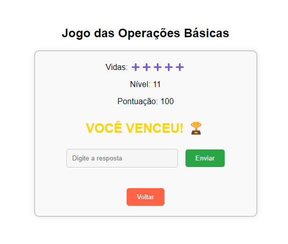
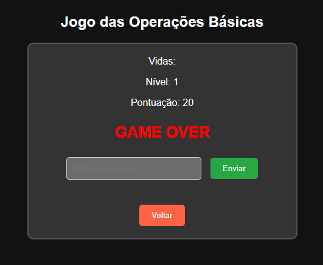

# Math Master

An educational browser game created as my undergraduate final project at **UERJ (Rio de Janeiro State University)**. Math Master uses gamification to make practising mathematics more interactive and engaging.

<p align="center">
  <a href="https://mathmaster-game.netlify.app/"><strong>Play Math Master</strong></a>
</p>

## About the project

Math Master brings together five mini-games covering key mathematical topics. Players answer questions, earn points, progress through levels and try to complete each challenge without losing all their lives.

## Features

- **Basic Operations:** practise addition, subtraction, multiplication and division.
- **Fractions:** solve questions involving fractions.
- **Exponentiation:** practise powers and exponents.
- **Percentages:** work with percentage calculations.
- **Equations:** solve mathematical equations.
- **Progressive challenges:** advance through 10 levels.
- **Score and lives:** earn points for correct answers and keep track of remaining lives.
- **Tutorials:** read instructions before starting each mini-game.
- **Light and dark themes:** switch the interface theme.

## Screenshots

The screenshots below show the main menu, the mini-games, the tutorial system and examples of the game states. They also include early interface iterations, showing the visual evolution of Math Master.

### Main menu and game selection

<p align="center">
  
</p>

The main screen introduces Math Master and gives players access to the available mathematical challenges.

<p align="center">
  
  
</p>

These early selection-screen designs show two visual theme options and the first layout of the mini-game menu.

<p align="center">
  
</p>

An early look at the percentage challenge, documenting one of the initial interface iterations.

### Mini-games

Each mini-game focuses on a different mathematical topic. Players solve the expression shown on screen by entering an answer and submitting it.

<p align="center">
  
  
</p>

- **Basic Operations:** practise calculations such as addition and other fundamental arithmetic operations.
- **Fractions:** solve fraction questions, including adding fractions.

<p align="center">
  
  
</p>

- **Exponentiation:** calculate powers and work with exponents.
- **Percentages:** solve percentage problems by calculating a percentage of a given number.

<p align="center">
  
</p>

- **Equations:** find the unknown value in a mathematical equation.

### Tutorials and game outcomes

<p align="center">
  
</p>

The tutorial screen explains the objective and rules of a mini-game before the player starts, including how to answer questions, earn feedback and manage lives.

<p align="center">
  
  
</p>

The game provides clear end states: a victory screen celebrates completing the challenge, while the Game Over screen appears when the player loses all available lives.

---

## Technologies

- HTML5
- CSS3
- JavaScript

## How to run locally

This project does not require a package manager or build step.

1. Clone the repository:
   ```bash
   git clone https://github.com/PedroHQCoelho/mathmaster.git
   ```
2. Open the project folder.
3. Open `index.html` in your browser.

You can also use a local development server in your code editor.

## Project background

This game was developed as my undergraduate final project at UERJ. The project explores how game-based experiences can support mathematics learning by making practice more interactive.

## Links

- **Live game:** https://mathmaster-game.netlify.app/
- **Repository:** https://github.com/PedroHQCoelho/mathmaster

---

# Math Master (Português)

Jogo educativo para navegador desenvolvido como meu Trabalho de Conclusão de Curso na **UERJ (Universidade do Estado do Rio de Janeiro)**. A proposta é tornar a prática de matemática mais dinâmica por meio da gamificação.

O projeto reúne cinco mini-jogos: operações básicas, frações, potenciação, porcentagem e equações. O jogador responde às questões, acumula pontos, avança por 10 níveis e precisa administrar suas vidas para chegar à vitória.

**Tecnologias:** HTML, CSS e JavaScript.

**[Acesse o jogo](https://mathmaster-game.netlify.app/)**
